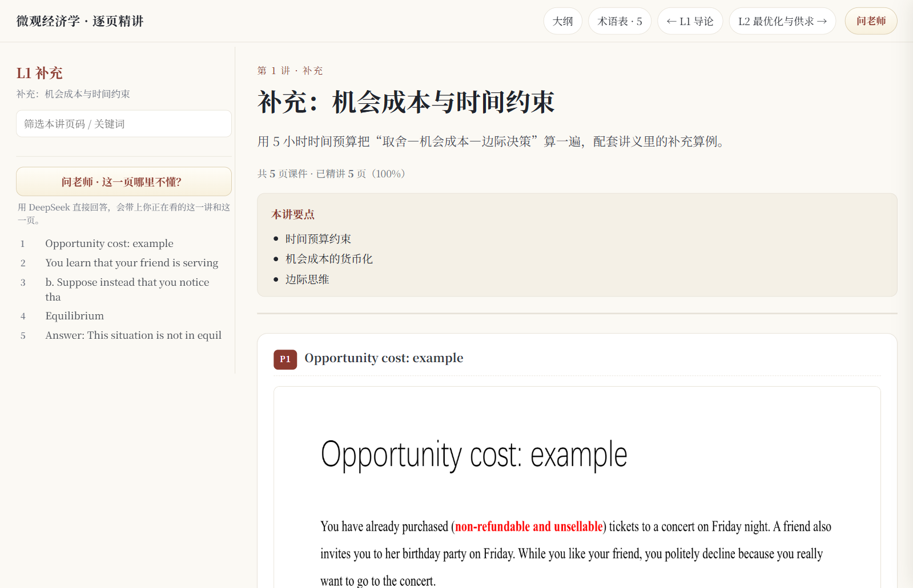
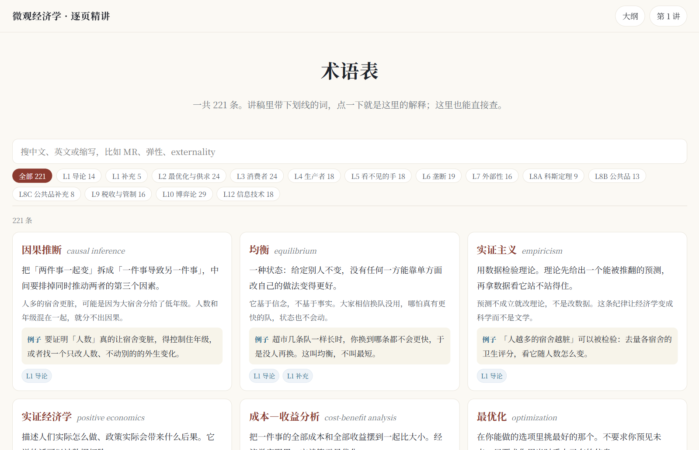

# ECON102 微观经济学 · 逐页精讲

把一门微观经济学课的 14 份课件（886 张幻灯片）逐页讲了一遍，做成一个能直接双击打开的网页：左边翻页码，右边是幻灯片原图和中文讲稿，正文里带下划线的术语点开就有解释，右上角还能就当前这页问 AI。

课程主线：选择与机会成本 → 最优化与供求 → 消费者 → 生产者 → 竞争均衡与福利 → 垄断 → 外部性 → 科斯定理与公共品 → 税收与政府失灵 → 博弈论 → 信息技术经济学。





## 怎么拿到手

### 方式一：git clone（会敲命令的用这个）

```
git clone https://github.com/wenlong-cloud/econ102-lecture-notes.git
```

进了仓库目录，双击 `docs/index.html` 就行。

### 方式二：直接下载仓库（不用装 git）

仓库页右上角绿色的 **`Code`** → **`Download ZIP`** → 解压 → 双击解压出来那个文件夹里的 `docs\index.html`。

下载的是整个仓库的快照，约 38 MB，绝大部分是 `docs/assets` 里那 886 张幻灯片图。里面真正能双击运行的入口只有 `docs/index.html` 一个，`src/` 和 `work/` 是讲稿源文件和生成脚本，不用管。

不用装 Python，不用装 Node，不用起服务器，不用联网。下载下来以后，整个文件夹可以拷到 U 盘、发给同学、放在任何一台电脑上——只要 `docs` 和它里面的 `assets` 待在一起（页面用相对路径找图）。

### 为什么不能在 GitHub 上直接点开看

GitHub 只会把 `.html` 当源码显示给你看，不会渲染成网页。想「在线阅读」得开 GitHub Pages，但那样等于把 886 张课程幻灯片挂成一个公开网站——不干这个，所以这里只提供下载，下载到本地跑。功能一点不少。

## 里面有什么

```
docs/            可直接双击打开的站点
  index.html       课程大纲 + 逐讲入口
  lec01.html ...   14 个讲次的逐页精讲
  glossary.html    术语表，221 条，可搜索、可按讲次筛
  assets/          886 张幻灯片图（WebP，1200px 宽）
src/            讲稿源文件（Markdown，一页一块）
  lec*.md          14 份讲稿
  gloss_*.json     术语数据（按讲次分开写的）
  glossary.json    合并去重后的术语表
  syllabus.json    讲次清单（页数、主题、图片目录）
  outline.md       课程大纲
work/           生成脚本
  build_site.py    把 Markdown + 术语 + 图片拼成整站
  make_docs.py     生成 docs/
  pack.py          打离线压缩包（自用，产物不进仓库）
  check_notes.py   检查讲稿有没有漏页、某页写得太短
preview/        README 里的截图
```

## 规模

| 项目 | 数量 |
|---|---|
| 讲次 | 14 份课件（第 8 讲按内容拆成三份：科斯定理 / 公共品新版 / 公共品补充） |
| 幻灯片 | 886 页，每一页都有对应的中文讲解 |
| 讲稿 | 约 19 万汉字 |
| 术语 | 221 条，每条有中英文、白话解释和一个例子 |
| 站点体积 | 约 38 MB（图片全压成 WebP） |

## 怎么读

- 左边是页码目录，点一条就跳过去；上面的框可以按页码或关键词筛。
- 键盘 `j` / `k` 或 `←` / `→` 翻上下一页。
- 讲稿里带下划线、淡黄底的词，点一下弹出解释和例子，ESC 关掉。
- 每页下面「幻灯片原文 / 板书」可以展开，看 PPT 上的英文原文。
- 点图片放大，再点一次还原。

## 关于「问老师」

右上角和左侧栏各有一个按钮，点开右边滑出对话框，可以就当前这一页提问。它会把你正在看的讲次、页码和这一页的讲义一起带上，所以问「这一步为什么能这么推」这种问题比较有用。

第一次用得先填一个 DeepSeek 的 API Key：

1. 去 <https://platform.deepseek.com> 注册（手机号就行）
2. 充一点钱（10 块够问上千次），左侧「API keys」→ 创建，复制 `sk-` 开头那串
3. 粘进对话框，点「保存并开始」

Key 只存在你浏览器的 localStorage 里，不会进这个仓库，也不会跟着代码传出去。代价是 Chromium 系浏览器里所有 `file://` 页面共用同一份 localStorage，所以别人发来的本地网页理论上也能读到它——自己电脑上无所谓，公共电脑上别填。

## 版权

幻灯片是课程作者（浙江大学 Mohan Zhou）和教材作者（Acemoglu–Laibson–List《Economics》、Landsburg《Price Theory》、Varian《Intermediate Microeconomics》）的东西，不是我的。放图片纯粹是为了「看着原图读讲稿」这个学习场景；**中文讲稿、术语解释、站点代码是我写的**。

所以：自己学、给同学看，随意；别拿去二次发布或商用。如果版权方希望撤掉，说一声我就把 `docs/assets/` 清空，文字部分照样能读。

## 顺带记两处课件笔误

- 第 7 讲有一页把「40 吨」印成了 400 吨，讲稿里按上下文改了。
- 第 3 讲的工资税例子，正文写 20%，但通篇数字（税后 10 元、工作 10 小时）只有按 50% 才自洽，讲稿按 50% 讲。
